# Advanced usage and troubleshooting

Start with the [quick start in the README](README.md#quick-start). This guide keeps the storage, report and recovery details available when you need them.

Jump to: [Smart lists](#comicrack-guru-cleanup-lists) | [Quality and actions](#actions-and-quality-settings) | [Pixel diagnostics](#quality-comparisons-and-pixel-diagnostics) | [Preview cleanup](#preview-storage-and-cleanup) | [Performance](#performance-and-large-batches) | [Resume](#continuing-after-a-stop-or-restart) | [Recovery](#replacement-recovery) | [History](#run-history) | [Setup](#setup-space-and-sleep)

## ComicRack Guru cleanup lists

I added these after **1.8 Convert to CBZ** in the Guru workflow's **01 - Clean Up** section. Search **Library** and choose **Custom Value** for each rule. Enter the field names and values below exactly; leave the value empty where it says blank. Use the normal **is** operator without negating it.

| Smart list | Match | Rules | Shows |
|---|---|---|---|
| **1.9 Run Image Format Check** | All | `ImageFormat` **is** blank | New books waiting for analysis. |
| **1.10 ImageFormat Errors** | **Any** | `ImageFormat` **is** `ERROR`; `WebPStatus` **is** `Needs attention` | Analysis or conversion problems to investigate. |
| **1.11 Convert To WebP** | All | `WebPStatus` **is** `Ready` | Eligible books waiting for conversion. |
| **1.12 WebP Skipped - Review** | All | `WebPStatus` **is** `Skipped` | Other skips, such as PNG eligibility or the selected CBR option. Check `WebPReason`. |
| **1.13 WebP Copies Created** | All | `WebPStatus` **is** `Copy created` | Originals with separate converted outputs; optional if you only replace originals. |

**Optional: 1.14 WebP Size Policy Skips**: Match All; Custom Value `WebPStatus` is `Skipped - size policy`. These books did not meet the savings threshold for the settings tested and do not need repair. Keep this as an informational list outside cleanup if you prefer. They can still be explicitly retried with different quality/policy choices.

For existing size-policy skips, select them from **1.12** and run **Analyze Only** once. Unchanged books with a recognized saved size-policy reason receive the new status without being converted again. **1.11** remains `WebPStatus is Ready`; its rule does not change.

**Important:** use **Match Any** for **1.10** so either rule can flag a problem. All the other lists use **Match All**. The new **1.11** replaces the previous `ImageFormat is not WebP` rules.

Run **Analyze Only** on new books from **1.9**. After conversion, the status moves books out of **1.11**: successful replacements become `Completed`, copies become `Copy created`, and skipped/problem books appear in their review lists. Quality tests leave the workflow status unchanged.

`ImageFormat` describes the source pages; `WebPStatus` tracks work on the book. For example, creating a WebP copy leaves the original's `ImageFormat` unchanged. See [workflow status](ADVANCED_USAGE.md#workflow-status) for more detail.

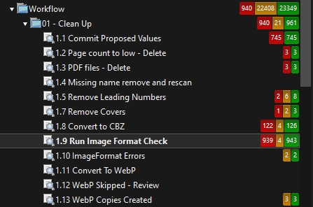

Smart-list setup screenshots

**1.9 Run Image Format Check**: Match All; ImageFormat is blank.

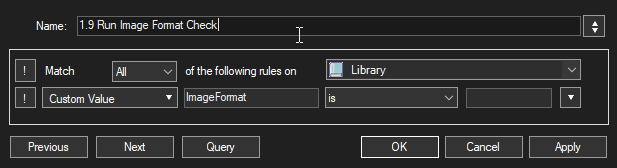

**1.10 ImageFormat Errors**: Match Any; ImageFormat is ERROR or WebPStatus is Needs attention.

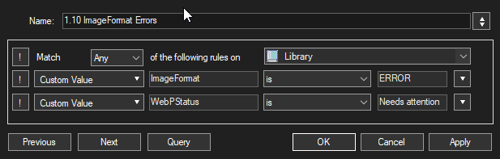

**1.11 Convert To WebP**: Match All; WebPStatus is Ready.

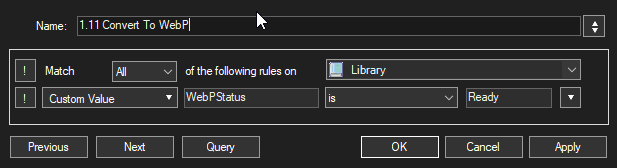

**1.12 WebP Skipped - Review**: Match All; WebPStatus is Skipped.

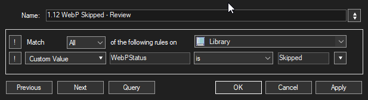

**1.13 WebP Copies Created**: Match All; WebPStatus is Copy created.

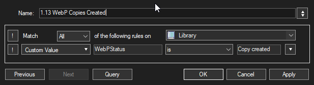

## Actions and quality settings

| Action | Behavior |
|---|---|
| Analyze Only | Inspect archives and update the image-format/workflow custom values; no conversion |
| Create WebP Copies | Keep the original and its library path; create separate converted output |
| Replace Originals | Validate the output, install it and update the existing library entry; optional retained original backup |
| Test savings & quality | Run Q60/Q70/Q75/Q80/Q90 on up to three eligible books spread through selection order; leave originals and workflow tags unchanged |

The quality dropdown offers Q60 through Q90. Q80 is the default; Q75 favors space savings. Reference estimates come from JPEG-page samples, not the selected library or whole-book predictions. No Resize and Only If Smaller are the defaults. The other size policies can require at least 3% savings, allow up to 1% growth, or retain all results.

ImageMagick is the recommended/default encoder. cwebp and Pillow are optional alternatives with different encoding implementations; selecting one requires that encoder to be available. There is no silent fallback. Pillow remains required for conversion validation regardless of the selected encoder. Existing WebP pages and preserved non-JPEG members are not re-encoded by the JPEG step. PNG-only/PNG-heavy archives are intentionally skipped.

CBR handling can convert to CBZ, skip CBR sources, or rebuild CBR using separately installed WinRAR. 7-Zip reads/extracts CBR input. CBR-to-CBZ replacement retains the existing ComicRack entry while changing its file path.

## Quality comparisons and pixel diagnostics

Enable Keep preview pages for a Test savings & quality run, then open previews from results. Choose a page and quality in the maximized native viewer. Each sampled book runs five complete conversions, so a quality test takes longer than one normal conversion.

| Control | Behavior |
|---|---|
| Mouse wheel | Scroll both panes vertically |
| Shift + wheel | Scroll both horizontally |
| Ctrl + wheel | Zoom both around the viewport center |
| 100% zoom | Show actual image pixels |
| F11 / Escape | Toggle full screen / return to window, then report |
| Hover either image | Read original and converted RGB at the matching image coordinate |
| Analyze differences | Calculate measurements for the current full-resolution pair in the background |
| Show amplified difference (8x) | Replace the right pane with a difference heatmap; uncheck to restore the WebP preview |

The heatmap uses the largest absolute RGB-channel change at each pixel, multiplied by eight and clipped to the display range. Black means identical RGB values; orange highlights changes. Amplification deliberately makes small differences easier to see and is not the normal appearance of the converted page.

| Measurement | Meaning |
|---|---|
| Mean change | Average absolute RGB channel difference, on a 0-255 scale |
| RMS | Root mean square RGB error; larger errors receive more weight |
| Max | Largest single-channel difference anywhere on the page |
| Brightness shift | Signed weighted encoded-RGB brightness estimate; positive means brighter on average, negative darker |
| Changed pixels | Percentage with any RGB difference, however small; not the percentage visibly damaged |

Measurements use the same detached, color-managed full-resolution bitmaps as the viewer, not screenshots or scaled pane pixels. Zoom does not change the measurements. They establish where/how RGB pixels differ, not a percentage of quality retained or a guarantee that a reader will notice a change. Brightness is an RGB estimate, not linear luminance, Delta E or SSIM; page averages can hide local differences, so use the heatmap and pixel inspector as well.

Analysis is optional, requires matching dimensions and supports up to 16 million pixels per page to limit memory use. It adds no work to normal archive conversion and no extra files or packages. Results are cached only for the active page/quality and released when switching or closing. A running job owns separate snapshots and discards its result if the viewer closes. Previews from retained older runs can be analyzed if their native image pairs remain available.

Example: Q80 comparison and amplified differences

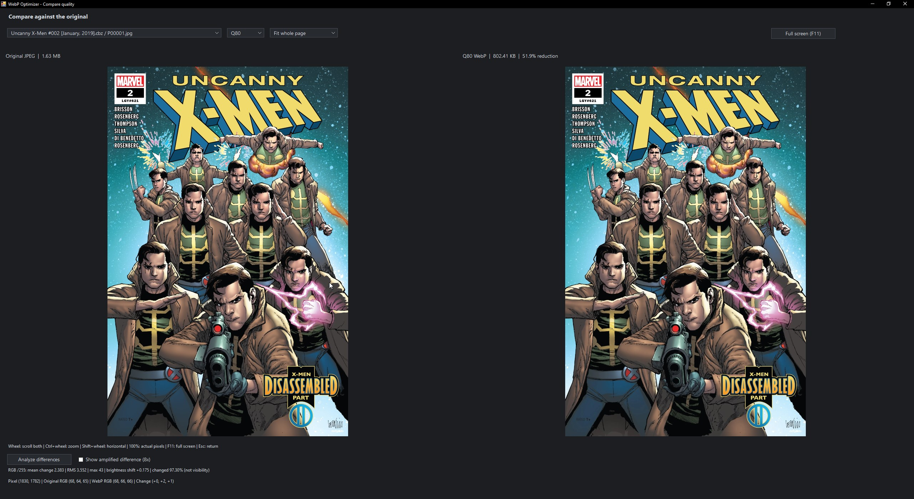

The comparison shows the original on the left and the converted Q80 page on the right. The size caption is for this page; whole-book savings are reported separately.

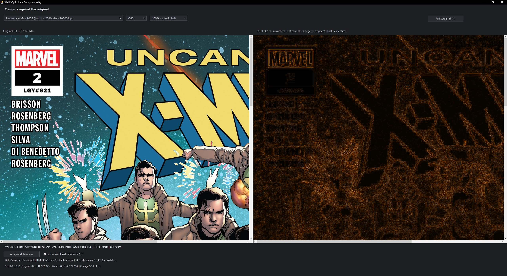

The orange view exaggerates RGB changes; it is not the appearance of the converted page. The coordinate inspector and full-page measurements remain available below the images. These screenshots illustrate the controls, not a lossless or perceptually identical result. JPEG screenshots are not suitable inputs for measuring encoder accuracy; use the live viewer's retained image pairs.

## Preview storage and cleanup

Preview files are saved in `Reports/QualityTests/<run-id>` inside this plugin folder. PNGs are lossless display copies of decoded WebP pixels and retain color profiles; captions use actual WebP sizes. These PNGs can be much larger than the WebPs.

**Delete this run's preview images when closing this results window** is checked by default. Leave it checked to remove that run's JPEG/WebP/PNG samples and manifest when closing results, including with X. Uncheck it to keep the run; the preference is remembered. Closing only the comparison popup does not delete previews, so you can reopen it from results. Text reports are retained. Cleanup failures show the remaining folder path. An app/process crash can leave previews behind for manual cleanup later.

This option only deletes the current generated run under `Reports/QualityTests`; it does not clear older runs, source comics, reports or backups.

## Storage, stopping and reports

Storage & advanced lets you choose a temporary work folder. Blank uses each source directory. Final comic output remains beside the source. Temporary space is still required even when replacing without a retained backup.

**Stop after current book** finishes the active book safely, then saves a partial-run report. During a quality test, it finishes all five quality passes for that book. Later books are marked not processed. Closing the progress window requests the same safe stop.

The results screen shows weighted total reductions and per-book outcomes; full details are in Technical report. Central text reports and structured `.run.xml` history records are kept in `Reports`. You can also save full run reports beside source files. Copy/test results and retained backups do not themselves reclaim the displayed savings from disk.

Options are remembered in `settings.xml` when starting a run. Restore defaults resets the dialog; Cancel leaves saved options unchanged.

Example: quality-test options and progress

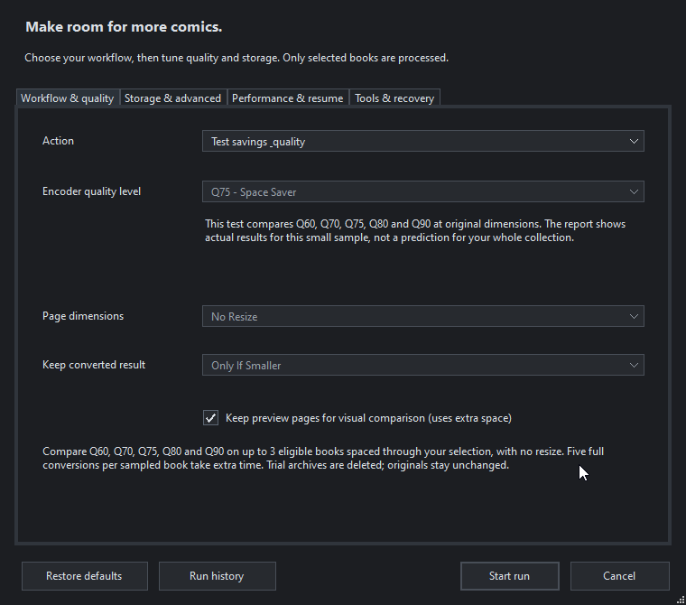

The quality test measures all five levels, even when a single-quality preset is shown in a disabled field.

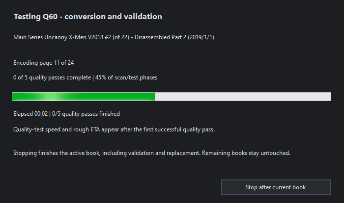

Speed and ETA appear after the first successful quality pass; stopping finishes all five passes for the active book.

## Performance and large batches

**Performance & resume > Concurrent pages** offers 1, 2, 4, 6, 8, 10 or 12 page encoders within the active book. One remains the conservative default. More workers need more RAM, especially for large scanned pages. Encoding and validation use the same worker budget at different stages. ZIP validation retains every member/CRC/hash/decode check and bounds pending compressed buffers to 64 MiB, except a single larger member. CBR validation remains sequential.

**Benchmark worker counts** tests all seven counts at your chosen quality, encoder and dimensions on up to 3 eligible JPEG-only books spaced through the selection. Quick performs one pass (up to 21 conversions); Thorough performs three passes in rotated order (up to 63). Each complete output is validated and deleted, without replacing originals, changing library tags or writing completion checkpoints. Output is staged beside each source, matching normal runs; temporary extraction uses your chosen folder. Stop finishes the active trial archive, then saves the partial results. Only a complete comparison receives a recommendation. Clicking **Use > workers** changes the options draft; starting a run saves that choice.

Results show full-run source MB/s, converted pages/s, average CPU, sampled peak RAM, logical process read/write MB/s and the longest stage. Full raw measurements, including stage times, CPU peaks and private commit, are retained in `Reports/PerformanceTests/<run-id>/report.txt`, with a `summary.csv`. Open these files directly to revisit a benchmark. CPU is normalized across all logical processors; RAM sums the helper and directly launched tools and can double-count shared pages. Short peaks may be missed. Process I/O includes cached and temporary activity: it is **not** physical drive or network throughput. Caching and other programs affect comparisons; rerun on representative originals before choosing a large-batch setting. The longest stage is a clue, not proof of a particular hardware bottleneck.

**PC priority > Background** lowers CPU scheduling priority for the helper and its tools. It does not cap RAM or throttle disk/network activity. Normal is suitable when dedicating the PC to conversion; choose workers independently in either mode.

**Prefetch one next archive** is optional and off by default. It requires an explicitly chosen local fixed-drive temporary folder (mapped/UNC network drives are excluded). During encoding it copies at most one next compressed archive, up to 256 MiB, with an additional 128 MiB free-space reserve. Larger books use normal processing. Cache reuse checks source size/mtime and a SHA-256 checksum; source identity, replacement guards and checkpoints still refer to the original. The consumed cache is removed after extraction before another is started. The worker acknowledges the exact cleaned manifest, avoiding another Python cleanup launch; missing acknowledgements retain guarded fallback cleanup. Reports include caches used/prepared totals and per-book `PREFETCH_*` fields, including usage, next-cache readiness, cleanup acknowledgements and fallback notes. Safe stop cleans a completed unused cache; unfinished copies are cancelled after the active read. Cleanup failures stop further books and identify remaining files. An app crash can leave a `webp_prefetch_<id>` folder in the chosen temporary location for manual review/cleanup. Prefetch adds simultaneous source reads and may hurt a busy drive, so compare with it off and on.

GPU encoding is not available in the bundled backends. ImageMagick's optional OpenCL operations do not provide a WebP GPU encoder; adding a GPU switch would not accelerate this workflow. See [ImageMagick OpenCL](https://imagemagick.org/opencl/) and [nvImageCodec's codec/backend table](https://github.com/NVIDIA/nvImageCodec).

For NAS collections, choose a local **Temporary storage** folder on Storage & advanced. Extraction and page conversion then use the local drive; the original still comes from the NAS and final output is staged beside it. Local work storage is optional. Blank continues to use each source folder. Ensure both locations have space for the active book; you do not need room for temporary copies of the entire collection.

Normal copy/replace runs scan one book immediately before processing it, avoiding a full-selection scan before conversion begins. Quality comparisons still inspect the selection to choose spaced eligible samples, then run all five quality levels fresh.

CBZ creation stores already compressed JPEG/PNG/WebP members directly and compresses XML/text. Validation checks member CRCs, hashes and image decoding in one archive-read pass. Image encoding quality and metadata checks are retained; ZIP storage can make an archive slightly larger than additionally deflating those same image bytes.

The progress window shows source MB/s and a rough remaining-time estimate after a completed conversion. Progress and ETA use cached ComicRack sizes when available and fall back to book count when sizes are unavailable. The batch bar advances at book boundaries; the stage label separately shows extraction, encoded-page counts, rebuilding, validation and replacement. Quality tests show speed after the first successful quality pass and estimate the remaining passes across the sampled books. Their throughput counts each quality pass separately. Eligibility, page complexity and NAS conditions can change the estimate. It does not scan the whole NAS just to calculate an ETA. Technical reports include stage timings; totals include extraction, encoding, rebuilding and validation, with scan and replacement timings listed separately for normal runs.

Example: performance and resume options

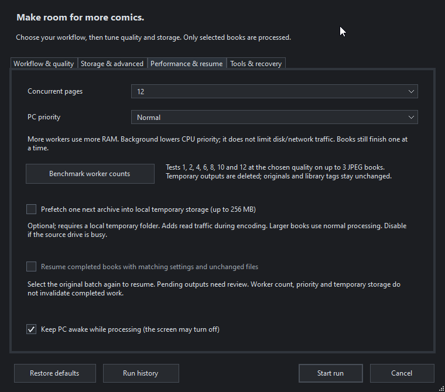

This capture shows the tester's settings, including 12 workers. New-install defaults remain one worker, Normal priority, prefetch off and completed-book recognition on; choose workers using your own benchmark.

### Continuing after a stop or restart

Leave **Resume completed books with matching settings and unchanged files** enabled. Select the original batch or its remaining books in ComicRack, review the same conversion choices, then start. There is no background scheduler or automatic selection of old sources.

Before each normal conversion, a pending checkpoint is saved under `Reports/Checkpoints`; successful completion is saved after replacement/library-update calls. Records include paths and measured results. Matching completed files are skipped without encoding again, and resumed work is not counted as newly reclaimed space. Books previously rejected by the same size policy are also recognized. Failed attempts are retried only when they leave no ambiguous output or recovery record.

Resume checks source/output sizes and modification timestamps, conversion settings and an explicit conversion-policy compatibility version. These are conservative identity checks, not full content hashes or file locks. Changing worker count or work storage does not invalidate completed work; changing quality, resize, encoder, CBR handling, size policy, backup choice or an incompatible conversion-policy version does. Compatible maintenance updates preserve completed-work recognition. Keep the records if you want resume recognition. Older runs made before checkpoint support cannot be reconstructed as checkpoints from their reports.

A completed CBR-to-CBZ checkpoint can recognize the new path and repair a selected old library path if the old file is missing and the recorded final file is unchanged. An unfinished attempt, corrupt checkpoint or unresolved replacement recovery record is reported for inspection; its output is never automatically installed or deleted. An unknown interrupted attempt requires review even if its output does not exist yet: a helper may still be encoding after ComicRack closes. Pending-attempt checks also apply when you disable completed-book reuse or change conversion settings. Do not start concurrent optimizer sessions against the same files.

For an interrupted attempt, open **Tools & recovery > Review interrupted work**. Select the attempt and choose **Check files**. Stop any remaining helper/encoder, inspect the named files, and resolve leftover converted/rollback files before checking again. Confirm that processing has stopped, then use **Allow retry** only when enabled. This archives tracking records and a resolved recovery note; it does not delete or install comic archives or start a conversion. Select the book and start a new run yourself.

Pending records from older builds can be reviewed. Completed records from the older implementation-signature scheme cannot be safely migrated and may require a fresh check/conversion; new version-2 checkpoints survive compatible maintenance updates.

If temporary cleanup fails, the report identifies the remaining work folder and processing stops after the active book. A force-close or crash can leave temporary pages and outputs; checkpoints do not automatically purge them or guarantee recovery from every network/power failure. Final text reports are still written on completion or graceful stop; per-book checkpoint XML provides durable completed-work records between those points. Preview cleanup does not delete checkpoints.

For your first large run, use a manageable batch with your chosen worker count and local storage, then inspect timings and free space. Copy mode and retained backups keep the originals, so they do not reclaim the reported savings.

## Replacement recovery

Replacement preserves recoverable files on failure and writes a `<source>.webp-recovery.txt` record before changing filenames. If an operation fails, inspect the report and named source/converted/rollback paths before retrying. An unresolved recovery record blocks another replacement. CBR-to-CBZ replacement refuses to overwrite an existing CBZ. Recovery is not a guarantee against every power-loss or network failure.

Start with a small disposable selection before a large replacement batch. Earlier local/NAS and reader workflow tests passed for the development installation; clean-machine installation and broader environments remain to be verified.

## Folder layout

| Location | Purpose | Included in release ZIP? |
|---|---|---|
| Root Python files, icons, package metadata and docs | Plugin runtime and user instructions | Yes |
| `Magick` | Static Windows x64 ImageMagick encoder, build identity and matching license notices | Yes |
| `quality_estimates.txt` | Reference sample reductions | Yes |
| `settings.xml` | Your saved choices | No |
| `Reports` | Your run reports and optional previews | No |
| `Development` | Tests, fixtures, calibration lab and implementation history | No |
| `Releases` | Generated distribution ZIP and checksum manifest | No |

Development commands and packaging instructions are in `Development/README.md`.

## Run history

Open **Run history** from Optimize Archives, or use the standalone **WebP Optimizer Run History** library action without selecting comics. Viewing history does not require Python, 7-Zip or an encoder to be available.

History lists date, action, processed-book count, run status, measured reduction and preview status. Open results reopens the native report; Open previews reopens retained native comparison images. Refresh updates the list after filesystem changes. Available means usable native preview images exist; Removed means a recorded cleanup removed them; Unavailable means files are missing, incomplete or from an older HTML-only run. A dash means no preview folder was recorded. Deleting previews removes only the selected run's generated preview folder and preserves the report.

**Historical results always start with Delete previews on close unchecked**, regardless of the default for new results. Reviewing old results will not delete their images. You may explicitly check the box or use Delete previews in history to remove them.

New runs save a `.run.xml` file beside the text report, including summary data, relevant options and source paths. Missing or damaged records fall back to the text report header; old reports therefore remain visible with whatever data is available. XML records contain personal paths and are excluded from release packages along with all Reports content. The history list reads only short headers for legacy reports rather than loading entire detailed reports.

From history opened through Optimize Archives, **Prepare new test** fills in recorded encoder/CBR/work-folder choices, selects Test savings & quality and enables preview retention. It does not convert anything or automatically reselect old files. Review the current ComicRack selection and settings, then explicitly start a new run. Source files may have changed since the old run, so results are recorded separately. The standalone library history view is for reviewing/deleting previews; open history through Optimize Archives to prepare a new test.

If a preview folder was removed, the report can still reopen but those images cannot be recovered from the report alone. Run a new comparison to recreate them. Report history is retained until its files are explicitly removed; there is no automatic report purge.

If opening history fails, check `Reports/history-diagnostic.log` for the recorded opening sequence and process identity. History and its report/preview windows run in a separate process. A helper failure returns an error and restores options. Check `Reports/history-helper-error.log` for startup/exit errors. This separation isolates the history windows; include these logs if a problem recurs.

Example: run history

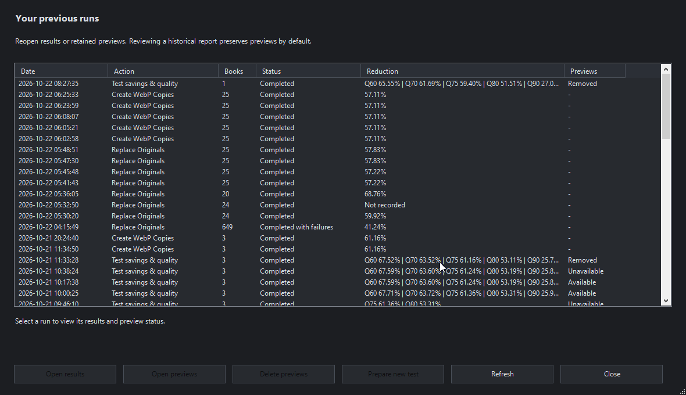

These are separate development runs, not one combined collection result. Select a row to enable its available actions. Removed previews cannot be reopened without running another comparison.

## Workflow status

Analyze the library after updating to populate these custom values. `ImageFormat` describes the source pages; `WebPStatus` describes the work outcome, and `WebPReason` explains it.

| WebPStatus | Meaning |
|---|---|
| Ready | Analysis found eligible pages |
| Completed | Replacement completed or was recognized from a matching checkpoint |
| Copy created | A separate converted output exists; the source remains unchanged |
| Already WebP | Source pages are already WebP |
| Skipped - size policy | Converted output did not meet the chosen savings/growth threshold; no repair needed |
| Skipped | Other intentional skips, including PNG eligibility or the selected CBR option; inspect WebPReason |
| Needs attention | Analysis/conversion failed or requires review |

Unchanged prior outcomes survive analysis. An explicit conversion can retry a skipped book with different choices. Quality comparisons do not mark the source completed. These labels are workflow aids; file checks still control replacement and resume safety.

## Setup, space and sleep

**Tools & recovery > Check setup** tests the prerequisites for the currently selected mode. Conversion checks perform a tiny real encode/decode and archive test in temporary storage. Analyze-only checks do not require Python. Nothing is installed automatically.

The pre-run summary uses cached ComicRack file sizes and a conservative storage scenario, not a full library rescan. Unknown sizes, unavailable shares, unusually large extracted pages and preview PNGs can make the estimate incomplete. Review both source and temporary-drive space.

**Keep PC awake** requests that Windows avoid automatic idle sleep during processing and restores the thread's previous request when the run ends or stops. It does not keep the display on, change your power plan or prevent manual sleep/shutdown. It is off by default.

Example: setup and recovery controls

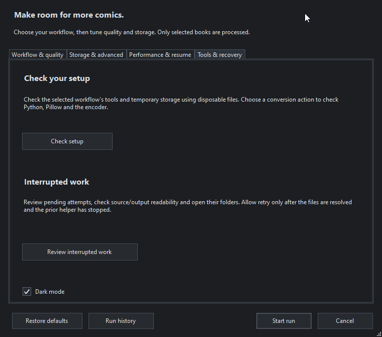

## Appearance and technical reports

Enable **Dark mode** on **Tools & recovery** to preview the palette. It is remembered when starting a run; Cancel or closing options discards the unsaved choice. Comic image pixels and color management are unchanged. Windows title bars also follow dark mode. Supported Windows versions use a muted grey caption; Windows 10 may use its native dark caption shade. Unsupported frame attributes leave the system appearance intact. Tab borders use subdued grey.

The **Technical report** tab preserves the complete report and adds bold labels, **Find next** and **Wrap long lines**. Search continues from the selection and wraps to the beginning. Copy report and Open report still use the full original text, including every path and diagnostic field.

Setup always reports whether WinRAR is available. Missing WinRAR is informational for analysis and CBZ output; selecting CBR rebuilding makes it a requirement and exercises a generated CBR. 7-Zip supplies CBR reading/extraction.

Pillow is currently a conversion requirement even with ImageMagick or cwebp: it supplies image decoding/dimension validation and color-profile-aware preview support. Selecting ImageMagick still uses ImageMagick for encoding; Pillow's encoder is an optional alternative. Analyze Only does not need Pillow or Python.

History uses the Windows PowerShell installed with Windows and the IronPython DLLs from your ComicRack installation. No extra Python package is required for history. The console is hidden; the native browser and previews remain visible. Startup may take a couple of seconds. The child receives no ComicRack objects and cannot start an archive conversion. Prepare new test returns settings for your existing selection; review them and explicitly start a run.

Temporary history-session XML files under Reports/HistorySessions are removed when the caller finishes, including after a helper failure. Reports and retained previews follow their existing retention rules. The launcher uses a process-scoped PowerShell execution-policy option; it does not change your saved system policy. Enforced organization policies may still prevent startup, which is reported without falling back into ComicRack's process.

## Size-policy skips and long filenames

`Skipped - size policy` is informational for the quality and size policy tested, not a claim that a book can never be reduced. PNG-only/PNG-heavy books and CBRs skipped by option continue to use `Skipped`; errors use `Needs attention`. Keep the generic skipped-review list separate from the optional size-policy list. Analyze Only upgrades recognized legacy size-policy messages only while the source stamp remains unchanged; it does not re-encode the book.

ImageMagick now receives page data through file handles, so deeply nested extracted names can be converted without requiring a local work folder. Original archive names/member names remain intact. Manifest mismatches still stop conversion; diagnostics now name all missing, unexpected and duplicate members. No mismatch is automatically ignored or installed.

An older failed run can leave a pending converted archive. New code does not delete or install it. Inspect the named files using the recovery workflow, resolve any old temporary output, then explicitly allow retry after confirming its worker has stopped.

Comic artwork visible in the example screenshots belongs to its respective creators and publishers. The plugin MIT license does not apply to that artwork.
