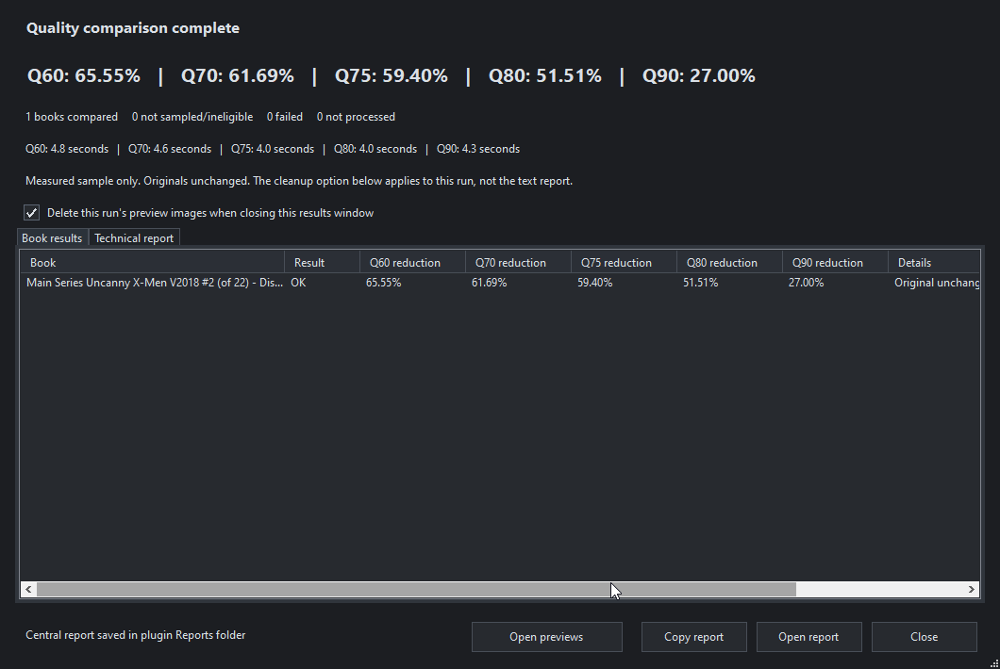

# WebP Optimizer

Make room in your comic collection from inside **ComicRack Community Edition**. Analyze CBZ/CBR archives, compare quality, and convert eligible JPEG pages to WebP. Replace originals without keeping permanent duplicates, or create separate copies.

**Current release: 1.1.0**

[Downloads](https://github.com/RayRayElite/comicrack-webp-optimizer/releases) | [User guide](ADVANCED_USAGE.md) | [Report a bug](https://github.com/RayRayElite/comicrack-webp-optimizer/issues) | [Contribute](CONTRIBUTING.md)

## Why I built it

The smaller WebP weekly bundles from GetComics made me wonder how much space I could recover from my own 1 TB+ collection. My comic drive was nearly full, so keeping another copy of everything wasn't practical. I already used public_fred's ComicRack Guru workflow, which made ComicRack integration a natural fit.

In my testing, I've typically seen **40% to 65% reductions in file size with no visible loss to my eye**. Results depend on the source and quality setting; compare your own books before choosing a batch setting.

## What it does

- Analyze books and add image-format/workflow values for smart lists.
- Create WebP copies or validate and replace originals, preserving the existing ComicRack entry, metadata and reading progress.
- Read CBZ/CBR; convert CBR to CBZ or optionally rebuild CBR with WinRAR.
- Compare **Q60/Q70/Q75/Q80/Q90** in a native viewer, with pixel readings and an optional difference heatmap.
- Remember settings, support dark mode, stop after the current book, and reopen reports or retained previews through run history.
- Offer local temporary storage, **1-12 page workers**, worker benchmarks and completed-work recognition for larger batches.

**Q80, original dimensions and Only If Smaller** are the starting defaults. Q is an encoder setting, not a quality or savings percentage. Savings vary; existing WebP pages are not recompressed. PNG-only/PNG-heavy books are skipped by the current JPEG-focused rules.



*Example from one tested book; savings vary by book and quality setting.*

## Requirements and installation

- **64-bit Windows**, ComicRack CE with scripting enabled, and 7-Zip (ComicRack's resource tools or a standalone Windows installation).
- **Python 3.9+ and Pillow**, installed separately. Start with the [official Python Windows installer](https://www.python.org/downloads/windows/), then follow the [step-by-step Python/Pillow setup](ADVANCED_USAGE.md#install-python-and-pillow-on-windows), including the verification commands. Pillow is required for validation/previews even with ImageMagick.
- **WinRAR only for CBR output**; reading CBR and converting it to CBZ do not need WinRAR.

The main download includes the ImageMagick encoder and its license notices. No separate ImageMagick or Visual C++ runtime installation is needed for that bundle. Python/Pillow are installed separately.

Install the prerequisites above first, then install the plugin:

1. Run ComicRack CE once, then close it.
2. Press **Win+R**, paste `%APPDATA%\cYo\ComicRack Community Edition`, and press Enter.
3. Create a folder named **Scripts** there if it does not exist.
4. Extract the ZIP's **WebP Optimizer** folder into **Scripts**. This is a manual-install ZIP, not a `.crplugin` installer.
5. Restart ComicRack, open **Optimize Archives**, and run **Tools & recovery > Check setup**.

The finished layout should include:

```text
%APPDATA%\cYo\ComicRack Community Edition\Scripts\WebP Optimizer\WebPOptimizer.py
```

Keep the other plugin files and `Magick` folder alongside it. Avoid an extra nested `WebP Optimizer` folder. AppData is normally hidden; **Win+R** opens it directly. For portable/custom installations or a plugin that does not appear, see [installation help](ADVANCED_USAGE.md#installation-folder-and-missing-scripts-folder).

When updating, keep your existing `settings.xml` and `Reports` folder. Source checkouts exclude the encoder executable; see the [developer instructions](Development/README.md).

## Quick start

**Open Optimize Archives using the green square in the top toolbar, or right-click selected books > Automations.** Only selected books are processed.

1. **Analyze your entire library first.** Select all books, choose **Analyze Only**, then **Analyze**. This populates `ImageFormat`, `WebPStatus` and `WebPReason` without converting files.
2. **Create the Guru cleanup lists below.** Use **1.9** for newly added books and **1.11** to find books ready to convert.
3. **Compare a small sample.** Choose **Test savings & quality**, enable **Keep preview pages**, then use **Open previews** in results. Try **Analyze differences** to inspect subtle changes.
4. **Choose Create WebP Copies or Replace Originals.** Start with disposable/backed-up books. For replacement, decide whether to retain an original backup.
5. **Start the run.** Review quality, storage and the pre-run summary. Check the results and reclaimed space afterward.

Temporary free space is required even when replacing without a backup. Copies and retained backups keep the originals, so the displayed savings are not yet reclaimed disk space.

### ComicRack Guru cleanup lists

Place these after **1.8 Convert to CBZ** in **01 - Clean Up**. Search **Library**, use **Custom Value**, and enter field names and values exactly.

| List | Match | Rules |
|---|---|---|
| **1.9 Run Image Format Check** | All | `ImageFormat` is blank |
| **1.10 ImageFormat Errors** | **Any** | `ImageFormat` is `ERROR`; `WebPStatus` is `Needs attention` |
| **1.11 Convert To WebP** | All | `WebPStatus` is `Ready` |
| **1.12 WebP Skipped - Review** | All | `WebPStatus` is `Skipped` |
| **1.13 WebP Copies Created** | All | `WebPStatus` is `Copy created` |


Use **Match Any** for the errors list. Check `WebPReason` for skips. `Skipped - size policy` means the output didn't meet the savings threshold and needs no repair; an optional informational list can track it separately. See [setup screenshots, upgrades and status meanings](ADVANCED_USAGE.md#comicrack-guru-cleanup-lists).

## Everyday use

- **Compare:** select page/quality; wheel scrolls both panes, Ctrl+wheel zooms, Shift+wheel scrolls horizontally, and F11 toggles full screen. The optional heatmap exaggerates differences **8x**; readings measure pixel changes, not quality retained.
- **Keep previews:** uncheck **Delete this run's preview images when closing this results window**. Reports remain either way; **Run history** reopens reports and retained previews.
- **Review results:** filter/search books, sort columns or use **Errors first**. View/copy an error, prepare a retry, review run settings or open the report folder. Optional status colors and editable support information make troubleshooting easier. See [results review](ADVANCED_USAGE.md#sort-results-and-share-one-entry).
- **NAS or large batches:** try a local SSD temporary folder and **Benchmark worker counts**. The default is one worker; more workers use more RAM. Background priority and optional prefetch are available.
- **Stop and continue:** **Stop after current book** finishes safely. Reselect the batch with matching settings to recognize completed work. Use **Review interrupted work** from an applicable error, the results **More** menu or **Tools & recovery** to check interrupted attempts, including in batches.

See the [error reference](ADVANCED_USAGE.md#error-reference) for failure messages and next steps, or the [user guide](ADVANCED_USAGE.md) for measurements, storage, reports, resume, recovery and performance details. Keep files named in a failed-replacement report until you have reviewed the [recovery instructions](ADVANCED_USAGE.md#replacement-recovery).

## Contributing and license

Feedback and pull requests are welcome. Start with [Contributing](CONTRIBUTING.md) and the [code map](ARCHITECTURE.md). Remove personal paths from shared reports and use disposable/generated examples.

Plugin code, documentation and original icons are [MIT licensed](LICENSE). Bundled components retain their own terms; see [third-party notices](THIRD_PARTY_NOTICES.md).

## Acknowledgements

Thanks to **GetComics** for the inspiration, **[maforget and the ComicRack CE contributors](https://github.com/maforget/ComicRackCE)** for ComicRack CE, **public_fred** for the Guru workflow, and **ImageMagick Studio LLC and contributors** for the recommended encoder.

## AI disclosure

This project was created with the help of **GPT 6.1 Sol**, which assisted with coding, debugging, documentation and testing during development.
